# 你好，我是陈艺航

**Agent 运行时与 AI 全栈应用开发工程师** ·  研究企业 AI 应用工作流

[字节跳动 / deer-flow](https://github.com/bytedance/deer-flow)（84.4k⭐）上游贡献者 · [已合并的上游 PR](#open-source-contributions)

> 关注 Agent 在真实业务中的任务执行、经验复用与持续迭代。

## 我做的事

- **企业工作流** — 主导从零到一开发交付与售后 Agent；参与跨境 CRM 的客户调研、商机分析与跟进建议链路。
- **运行时与工具治理** — 参与完善任务状态、超时重试和断点恢复，规范工具调用边界与关键操作的人工确认。
- **上下文与记忆** — 构建项目级上下文，按客户与项目隔离记忆，将高频排障经验沉淀为可复用 Skill。
- **评测与全栈交付** — 用历史 Case 与 Trace 回归任务效果，参与 React / Next.js 工作台、SSE 进度回放和容器部署。

## 个人项目

- **opendot（开发中）** — 第一段实习结束后，基于我主导从零到一开发的企业 Agent 项目，在对企业信息脱敏的基础上沉淀技术与工程经验，正在将其扩展为面向个人任务与工作流的 Personal Agent。

## Open-source contributions

我的公开已合并 PR。点击卡片查看完整修改、评审与合并记录。

<!-- MERGED-PRS:START -->

**12 merged PRs · 2 repositories** · [查看全部](https://github.com/pulls?q=is%3Apr+is%3Amerged+author%3ACordis798)

[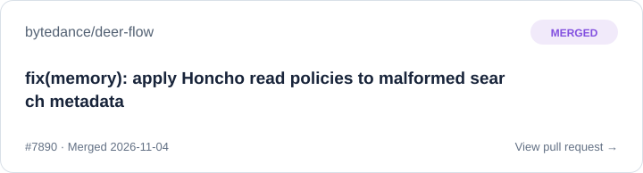](https://github.com/bytedance/deer-flow/pull/7890)

[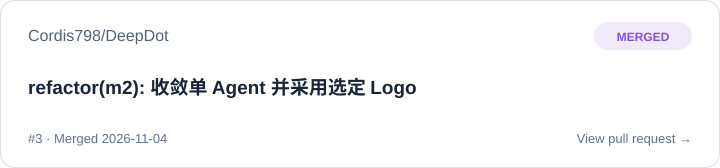](https://github.com/Cordis798/DeepDot/pull/3)

[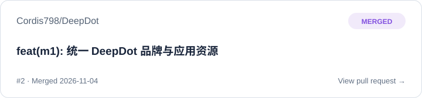](https://github.com/Cordis798/DeepDot/pull/2)

[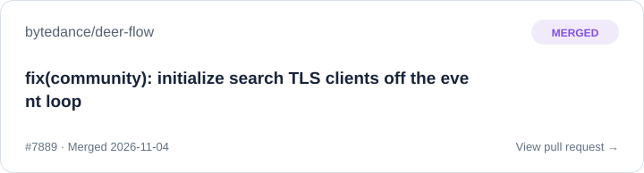](https://github.com/bytedance/deer-flow/pull/7889)

[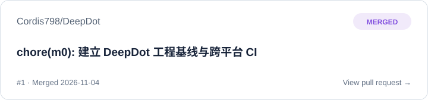](https://github.com/Cordis798/DeepDot/pull/1)

[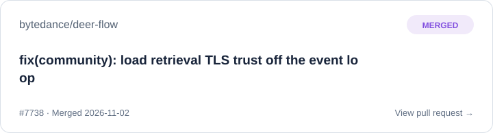](https://github.com/bytedance/deer-flow/pull/7738)

[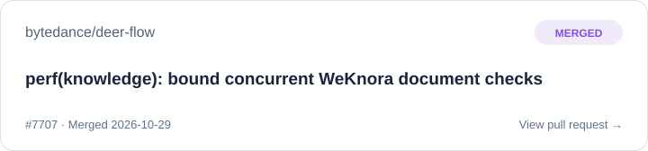](https://github.com/bytedance/deer-flow/pull/7707)

[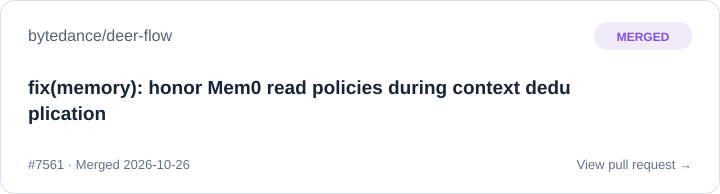](https://github.com/bytedance/deer-flow/pull/7561)

[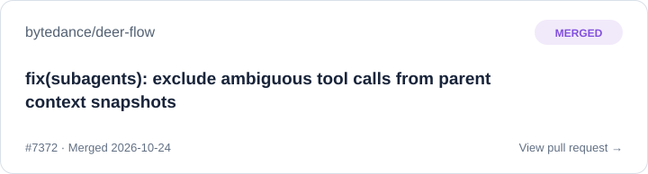](https://github.com/bytedance/deer-flow/pull/7372)

[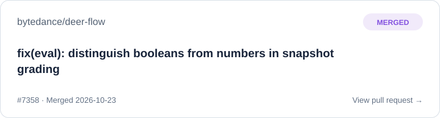](https://github.com/bytedance/deer-flow/pull/7358)

[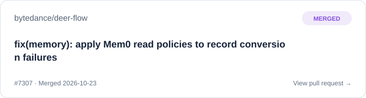](https://github.com/bytedance/deer-flow/pull/7307)

[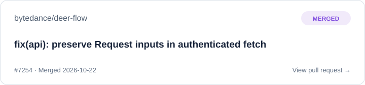](https://github.com/bytedance/deer-flow/pull/7254)

<!-- MERGED-PRS:END -->

每 6 小时自动更新；仅展示 GitHub 确认已合并的公开 PR。
